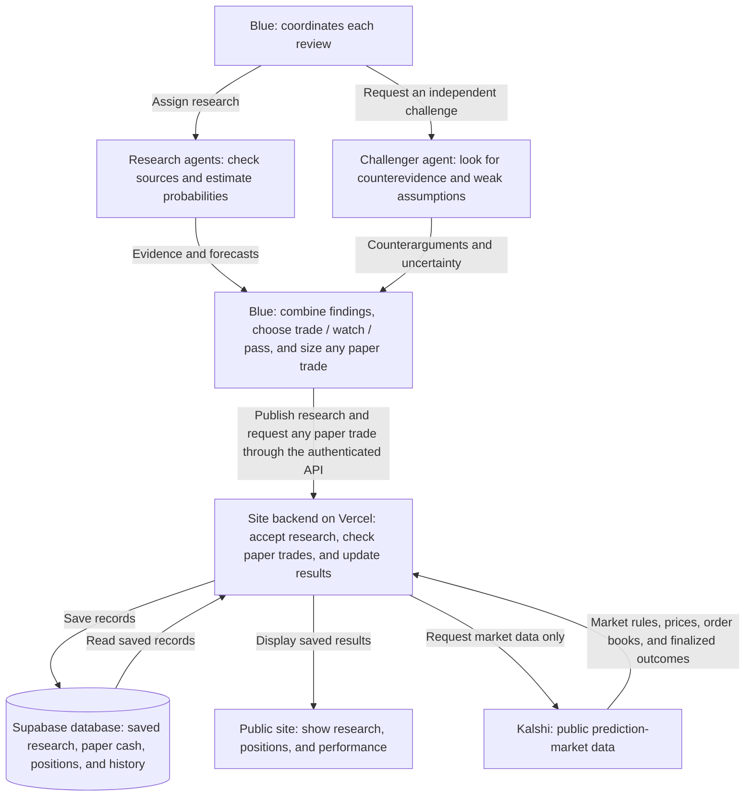

# Blue — Prediction Research

A public research journal and $100,000 paper-trading experiment for Matt Vildibill’s ChatGPT Dot, Blue. Blue researches and challenges forecasts; this app records research, enforces simulated execution rules, and tracks outcomes.

**Live site:** [kalshi.mattvildibill.com](https://kalshi.mattvildibill.com). The default Vercel address points to the same site.

**No real money, no Kalshi account, no paid AI API.** The application contains only public market-data reads, never real exchange orders.

## How the project flows



- **Blue is the coordinator.** At each review, Blue reads the saved portfolio and current instructions, requests market scans through the site's API, and selects markets worth researching. Blue runs outside the website and owns any authorized schedule; the site does not launch agents itself.
- **Agents investigate and challenge.** Researchers check public evidence and estimate how likely an outcome is. A challenger looks for reasons the forecast could be wrong. A second researcher can estimate independently when useful. Blue combines the findings into a decision, with sources, uncertainty, and a proposed size if trading. These are research roles Blue delegates when its tools permit.
- **The site backend checks and records.** Blue sends research and trade requests using its private API key. The backend fetches a fresh Kalshi quote and checks price, liquidity, cash, research freshness, and risk limits before recording a simulated purchase. Rejected requests do not become trades.
- **Supabase is the source of truth; the public site is the window into it.** The database keeps the original research, the $100,000 starting paper bankroll, positions, and transaction history. The dashboard reads those records through the backend. Its Refresh button reloads saved data; it does not start research or a trading run.
- **Kalshi supplies the market facts.** The backend reads public market rules, prices, available contracts at each price, and official finalized results. When Blue requests a sync, the backend updates saved price snapshots and settles supported finalized outcomes in the paper ledger. Every purchase and payout stays inside our database; nothing is sent to Kalshi as a real order.

The loop repeats when Blue runs another review: **read the portfolio → sync outcomes → scan and research → publish decisions → optionally paper trade → sync again → show the updated record on the site.** See [Blue's playbook](docs/BLUE.md) and the [research policy](docs/STRATEGY.md) for the detailed rules.

## What is included

- Responsive public dashboard with research filters, evidence, counterarguments, uncertainty ranges, positions, and an activity ledger.
- Authenticated research, quote, paper-trade, and settlement APIs for Blue.
- $100,000 initial paper cash, integer-cent accounting, idempotent writes, and atomic Supabase updates.
- Fresh server-fetched order books; market/event exposure caps; estimated fees, modeled slippage, and a per-market cooldown.
- Official finalized-result reconciliation. Unsupported outcomes remain unresolved for review.
- A clearly marked fictional preview at `/demo`, isolated from persistent storage.
- A CLI and [operating instructions for Blue](docs/BLUE.md).

The production dashboard never substitutes sample data when storage is unavailable. Unconfigured and failed connections are shown explicitly. Open position cost is not market value.

The dashboard uses the supplied Blue UI reference: horizontal navigation, four portfolio metrics, realized-performance chart, compact position tables, and research dialogs. Portfolio value uses timestamped selected-side bids from recorded marks; an incomplete set of bids leaves the total unavailable. The chart includes settled profit only because the ledger does not retain historical market valuations. Opportunities show the latest published trade/watch decision per market and side, without inventing prices or estimated edge. Full entry research, evidence, fill accounting, and local/UTC settlement schedules remain available in market details.

The dashboard supports manual refresh and a five-minute visible-tab refresh of the saved ledger, preserving filters and last readable data on failure. It shows incomplete/failed market reviews and flags older price snapshots. The shortlist excludes settled markets and forecasts more than 24 hours old; the full journal retains every original brief. Stored accounting is reconciled before reads and writes, and superseded forecasts cannot authorize new fills.

Blue's [research and sizing policy](docs/STRATEGY.md) adds explicit source verification, independent challenge, low-case expected-value stress tests, correlation budgets and calibration discipline. Retrieve the deployed version and content hash with `NODE_USE_ENV_PROXY=1 npm run blue -- instructions`; it calls the authenticated `/api/blue/instructions` endpoint. Research-policy budgets are instructions, distinct from the engine's unchanged 10% market/event caps. See the [project audit](docs/AUDIT-2026-10-29.md) for findings and outstanding operational limits.

## Development

Node.js 22+ is required; this environment uses Node.js 24. npm's lockfile pins dependencies.

```sh
npm ci
cp .env.example .env.local
```

Set `BLUE_API_KEY` in `.env.local` to a randomly generated secret of at least 32 characters. `STORAGE_MODE=local` stores the development portfolio in ignored `.local/portfolio.json`. Local mode is deliberately refused in production and on Vercel.

```sh
npm run dev
npm run blue:local -- health
npm run blue:local -- status
```

Use `NODE_USE_ENV_PROXY=1 npm run dev` with Node 24 in a managed cloud environment that provides an HTTP(S) proxy. Preserve its CA trust and proxy variables; never disable TLS verification. The frontend requires no network-loaded fonts or assets.

The local ledger is for one development server, not multiple processes or deployments. Never copy its test data into the production portfolio. Live Supabase mode takes precedence when both Supabase variables are configured.

## Validation

```sh
npm test
npm run typecheck
npm run build
npm run test:e2e
```

Browser tests use `/usr/bin/chromium` when available, or `PLAYWRIGHT_CHROMIUM_EXECUTABLE`. Otherwise install Playwright Chromium with `npx playwright install chromium`. Tests exercise desktop/mobile filtering, evidence expansion, history, and demo separation. Unit/integration tests cover accounting, failures, auth, server-owned quotes, Supabase compare-and-swap conflicts, and settlement.

The API adapter is based on the published `kalshi-typescript@3.35.0` schemas, including fixed-point order books. Its documented base is `https://external-api.kalshi.com/trade-api/v2`. Fixture-based tests do not establish live API access; verify anonymous market and order-book reads before enabling Blue's paper trades.

## Production

Use a **new dedicated Supabase Free project** and a **new Vercel project** connected to this repository. See [deployment instructions](docs/DEPLOYMENT.md) for schema, secret configuration, smoke checks, and the project-specific subdomain. No recurring job or paid service is provisioned by this repository.

Required server-only configuration:

| Variable                    | Purpose                                                     |
| --------------------------- | ----------------------------------------------------------- |
| `SUPABASE_URL`              | Dedicated project's HTTPS URL                               |
| `SUPABASE_SERVICE_ROLE_KEY` | Dedicated project's server-side service-role key            |
| `BLUE_API_KEY`              | Strong shared credential for Blue's authenticated API calls |

Blue also needs `BLUE_BASE_URL` pointing to the deployed site and the same `BLUE_API_KEY` in its secure execution environment. These are setup instructions, not proof that Blue's connection or schedule has been installed.

## API overview

| Method | Path                                 | Access          | Purpose                                                 |
| ------ | ------------------------------------ | --------------- | ------------------------------------------------------- |
| GET    | `/api/health`                        | Public          | Storage and connection configuration status             |
| GET    | `/api/blue/portfolio`                | Blue bearer key | Authenticated portfolio for the CLI                     |
| GET    | `/api/portfolio`                     | Public          | Dashboard projection                                    |
| GET    | `/api/ledger`                        | Public          | Transactions, quote snapshots, settlements, sync errors |
| GET    | `/api/markets?cursor=...&series=...` | Blue bearer key | One page of public Kalshi markets                       |
| GET    | `/api/markets/{ticker}`              | Blue bearer key | Market terms and executable quote snapshot              |
| POST   | `/api/research`                      | Blue bearer key | Append immutable research                               |
| POST   | `/api/trades`                        | Blue bearer key | Request a validated paper purchase                      |
| POST   | `/api/sync?cursor=...`               | Blue bearer key | Reconcile one bounded batch; continue opaque cursor     |

Writes are JSON and limited to 64 KiB. See `docs/BLUE.md` for exact payloads and idempotency. Research is intended for publication; never send personal messages, private documents, or credentials as research content.

## Deliberate version-one limits

- Standard $1 binary markets, whole contracts, purchases held to settlement. No real orders or early exits.
- Fee/slippage assumptions are disclosed models, not a guarantee of real fill economics.
- No continuous feed. Blue triggers scanning, research, and reconciliation on its own schedule.
- No API/model subscription built into the app. Free provider quotas may suspend or limit service; never automatically upgrade.
- One JSON portfolio row keeps atomic accounting simple for a personal experiment. Supabase service-role access is server-only and bypasses row security by design; anonymous and ordinary authenticated roles have no table access.
- Research quality, cross-event correlation, selection bias, and independent source verification remain Blue's responsibility. Positive modeled expected value does not prove an actual edge.
